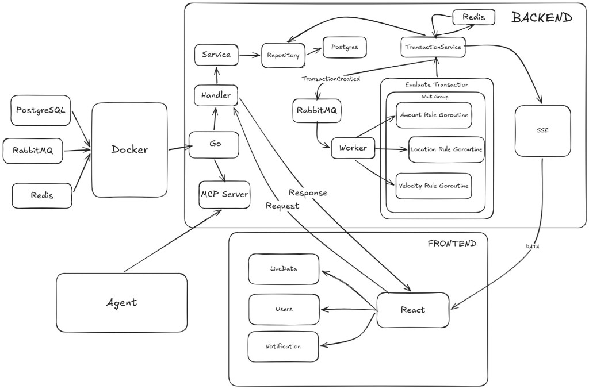

## PROJECTS PURPOSE AND SCOPE

This repository is a **fraud-detection** demo stack: a **Go (Gin)** backend stores users and transactions in **PostgreSQL**, publishes new transactions to **RabbitMQ**, and runs **asynchronous fraud evaluation** (rules such as amount, location, and velocity). Results are written back to the database, cached in **Redis** where relevant, and streamed to a **React (Vite + TypeScript)** dashboard over **Server-Sent Events (SSE)**. Optional **bash** scripts help generate load or single transactions for testing. An **MCP (Model Context Protocol)** server over **stdio** exposes read-only tools for agents (recent frauds, user status).

---

## SYSTEM ARCHITECTURE AND COMPONENTS EXPLANATION

Infrastructure runs in **Docker** ([`docker-compose.yml`](docker-compose.yml)): **PostgreSQL**, **Redis**, and **RabbitMQ** (with the management UI on the mapped management port). The **backend** (`backend/`) is a Go service using a classic **handler → service → repository** layout against Postgres. **Transaction** creation goes through the service, touches Redis where transaction state is cached, and emits work to **RabbitMQ**. **Fraud workers** consume those messages, evaluate rules (including concurrent rule checks), update fraud status, and notify subscribers. **SSE** pushes live transaction updates from the backend to the **fraud-dashboard** (`fraud-dashboard/`), which talks to the API over HTTP during development via the **Vite dev proxy** ([`fraud-dashboard/vite.config.ts`](fraud-dashboard/vite.config.ts)). An external **MCP client** (e.g. Cursor or MCP Inspector) can attach to the same binary’s **stdio MCP** surface when enabled.

### Architecture diagram (image)

**[`docs/architecture.png`](docs/architecture.png)** 



---

## PROJECT SETUP STEPS

1. **Clone** this repository and `cd` into it.

2. **Environment for Docker Compose**  
   At the **repository root**, create a `.env` file with the variables expected by [`docker-compose.yml`](docker-compose.yml) (same names as in [`backend/.env.example`](backend/.env.example): 
   Postgres database/user/password/host/port,
   Redis host/port, 
   RabbitMQ host/port/user/password/management port). `docker compose` reads the root `.env` for substitution.

3. **Start infrastructure**

   ```bash
   docker compose up -d
   ```

4. **Backend environment**  
   Copy [`backend/.env.example`](backend/.env.example) to `backend/.env` and adjust values so they match your Docker services (host `localhost` and ports from compose unless you override them).

5. **Run database migrations**  
   Migrations run automatically when the API process starts (`backend/cmd/api/main.go`).

6. **Run the API**

   ```bash
   cd backend
   go run ./cmd/api
   ```

   Or build and run:

   ```bash
   cd backend
   make build
   make run
   ```

   Default HTTP listen address is **`:8080`** (Gin).

7. **Run the dashboard**

   ```bash
   cd fraud-dashboard
   npm ci
   npm run dev
   ```

   The dev server proxies **`/api/*`** to `http://localhost:8080` (with the `/api` prefix stripped) so browser routes like **`/users`** stay the SPA while fetches use **`/api/users`**, etc. See [`fraud-dashboard/vite.config.ts`](fraud-dashboard/vite.config.ts) and [`fraud-dashboard/src/api/endpoints.ts`](fraud-dashboard/src/api/endpoints.ts).

---

## USAGE GUIDE

- With **Docker** and **`backend/.env`** configured, start the API, then start **`fraud-dashboard`** in dev mode.
- Open the dashboard URL printed by Vite (typically **`http://localhost:5173`**). Ensure the API is on **port 8080** or change the proxy target in `fraud-dashboard/vite.config.ts`.
- Use **Swagger UI** for interactive REST exploration: **`http://localhost:8080/swagger/index.html`** (after the API is running).
- **Live transactions** page consumes **SSE** at **`/stream/transactions`** (proxied from the dashboard in dev).
- **Users** pages list users and show per-user transaction charts/tables with optional date filters.

---

## API USAGE

High-level REST surface (see Swagger for schemas and status codes):

| Area | Examples |
|------|----------|
| Users | `POST /users`, `GET /users`, `GET /users/:id` |
| Transactions | `POST /transactions`, `GET /transactions`, `GET /transactions/:id`, `DELETE /transactions/:id` |
| By user | `GET /transactions/user/:id`, `GET /transactions/user/:id/detail`, `GET /transactions/user/:id/summary` |
| System | `GET /health` |

Implementation entry points: [`backend/internal/user/handler.go`](backend/internal/user/handler.go), [`backend/internal/transaction/handler.go`](backend/internal/transaction/handler.go). Prefer **Swagger** for request/response models and query parameters.

---

## MCP USAGE

The backend can expose an **MCP server on stdio** (tools implemented in [`backend/internal/mcp/server.go`](backend/internal/mcp/server.go)) when **`MCP_STDIO_ENABLED=true`**.

- **`get_recent_frauds`** — `from` (required) and `to` in **`DD.MM.YYYY`** (zero-padded day and month). If **`to`** is omitted or empty, the range end is **now** (local clock). Optional `limit`.
- **`check_user_status`** — `user_id` (UUID string).

For **MCP Inspector** or other stdio clients, avoid binding **HTTP :8080** in the same process by also setting **`MCP_STANDALONE=true`**: only stdio MCP runs (no Gin), which prevents **“address already in use”** when you already run the API on 8080 or when a previous Inspector child left the port busy.

From the **`backend/`** directory (where `go.mod` lives and `godotenv` loads **`backend/.env`**):

```bash
cd /path/to/fraud-detection/backend
go build -o bin/api ./cmd/api
MCP_STDIO_ENABLED=true MCP_STANDALONE=true npx @modelcontextprotocol/inspector ./bin/api
```

Use the **full path** to `./bin/api` in Inspector’s **Command** field if the working directory is not `backend/`. Ensure **`backend/.env`** exists so Postgres (and other deps) match your Docker stack.

For **Cursor** or full **API + MCP** in one process, enable **`MCP_STDIO_ENABLED`** only and omit **`MCP_STANDALONE`** so Gin still listens on **8080**.

---

## SCRIPTS USAGE AND PARAMETERS

### `backend/scripts/auto-test.sh`

Sends synthetic `POST /transactions` traffic against a running API.

| Option | Meaning | Default |
|--------|---------|---------|
| `--duration=<seconds>` | How long the script runs | `30` |
| `--rate=<rps>` | Requests per second | `5` |
| `--anomaly=<0-100>` | Probability of “anomaly-style” requests | `30` |
| `-h`, `--help` | Help | |

Environment: **`BASE_URL`** (default `http://localhost:8080`).

Example:

```bash
cd backend
./scripts/auto-test.sh --duration=20 --rate=5 --anomaly=50
```

### `backend/scripts/manual-input.sh`

Creates **one** transaction via `POST /transactions`.

```text
./scripts/manual-input.sh <user_id> <amount> <location> [--base-url URL]
Example: ./scripts/manual-input.sh 1a24123e-c7dd-4817-895d-e7f4260d06ca 3000 istanbul
```

Requires **`curl`** and **`jq`**. **`BASE_URL`** defaults to `http://localhost:8080`.

---

## MCP TEST DOCUMENTED

1. Build the binary and start **MCP Inspector** from **`backend/`** with **`MCP_STDIO_ENABLED=true`** and **`MCP_STANDALONE=true`** (see [MCP USAGE](#mcp-usage)).
2. In the Inspector UI, choose **stdio**, set **Command** to your built **`bin/api`** (or `go` with `-C` and arguments per Inspector docs), **working directory** to **`backend/`**, and pass the same env vars as in `.env`.
3. Click **Connect** — you should see tools **`get_recent_frauds`** and **`check_user_status`**.
4. Run **`get_recent_frauds`** with e.g. `from` **`01.05.2026`**, leave **`to`** empty for “until now”, or set **`02.05.2026`** for an end-of-day upper bound; expect JSON array of fraud transactions or a clear tool error string.
5. Run **`check_user_status`** with a valid **`user_id`** UUID; expect JSON with user fields including **`risk_rate`**.
6. Optional automated parse tests: `cd backend && go test ./internal/mcp/ -count=1`.
