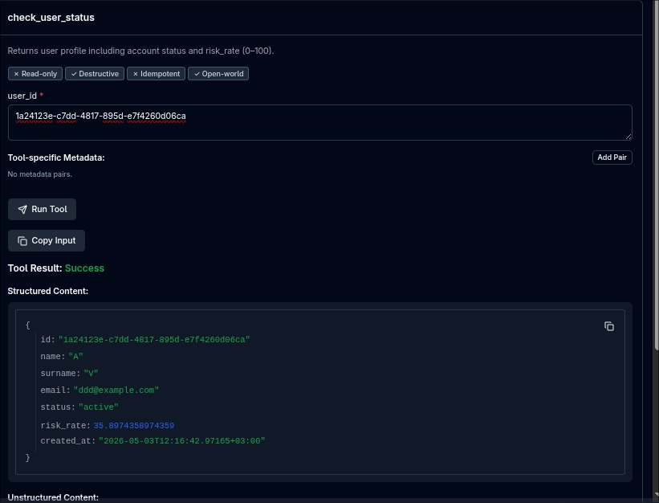
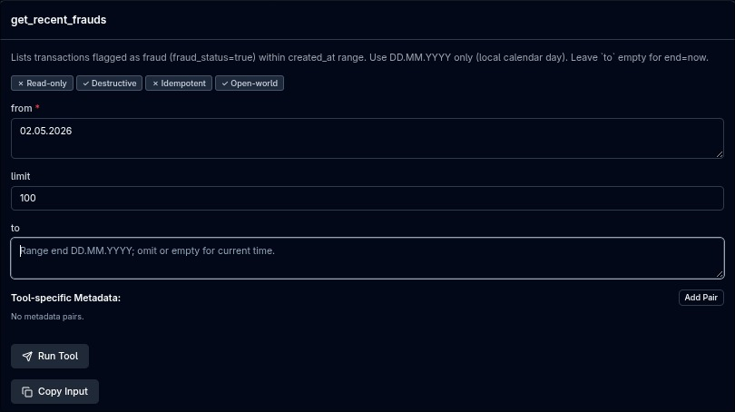

## PROJECTS PURPOSE AND SCOPE

This repository is a **fraud-detection** demo stack: a **Go (Gin)** backend stores users and transactions in **PostgreSQL**, publishes new transactions to **RabbitMQ**, and runs **asynchronous fraud evaluation** (rules such as amount, location, and velocity). Results are written back to the database, cached in **Redis** where relevant, and streamed to a **React (Vite + TypeScript)** dashboard over **Server-Sent Events (SSE)**. Optional **bash** scripts help generate load or single transactions for testing. An **MCP (Model Context Protocol)** server over **stdio** exposes read-only tools for agents (recent frauds, user status).

---

## SYSTEM ARCHITECTURE AND COMPONENTS EXPLANATION

Infrastructure runs in **Docker** (`[docker-compose.yml](docker-compose.yml)`): **PostgreSQL**, **Redis**, **RabbitMQ**, `api` (`[backend/Dockerfile](backend/Dockerfile)`), `web` (`[fraud-dashboard/Dockerfile](fraud-dashboard/Dockerfile)`). The backend uses **handler → service → repository**; RabbitMQ consumers and optional stdio MCP run **in the same `api` process** as Gin. Local dashboard dev uses **Vite** (`[fraud-dashboard/vite.config.ts](fraud-dashboard/vite.config.ts)`); the `web` image serves the built SPA and proxies `api` to `api:8080`.

### Technology choices (why these parts)

- **Go**  One compiled program can host the HTTP API, background RabbitMQ consumers, and optional MCP in the same process with clear wiring. The standard library and common patterns (interfaces, explicit error handling) keep the fraud pipeline and storage code easy to read and change. It was also a good fit for learning the language on a small, end-to-end service.
- **React (Vite + TypeScript)**  The dashboard is mostly lists, forms, charts, and a live feed. React’s component model and TypeScript’s types help keep that UI organized as it grows. **Server-Sent Events** map cleanly to “append or update rows when the server pushes an event,” without a custom binary protocol in the browser.
- **RabbitMQ**  Fraud runs **after** the HTTP handler returns, so work needs a small, reliable queue. RabbitMQ fits a single exchange / routing setup and is straightforward to run in Docker for a demo. **Kafka** would add more moving parts (topics, partitions, retention tuning) than this project needs.
- **Redis**  Fraud rules reuse short-lived state (request counts in a time window, optional cached averages, last location for travel checks). Redis supports keys with TTL and sorted sets with scores, which matches those patterns without adding another application-specific service.

### Architecture diagram

`[docs/architecture.png](docs/architecture.png)` — high-level system view.

### Backend composition (`[backend/cmd/api/main.go](backend/cmd/api/main.go)`)

The API process is wired manually in `main`: config and connections first (Postgres, Redis, RabbitMQ), then repositories, **Redis transaction state** cache, **SSE hub**, services, **RabbitMQ publisher**, **fraud worker** pool, **Gin** routes, and optionally **MCP stdio** in a goroutine. Fraud evaluation does **not** run inside the HTTP handler; it runs in **RabbitMQ consumer** goroutines started from the same binary.

### HTTP request flow (synchronous)

For REST traffic the pattern is `Handler → Service → Repository → PostgreSQL` (GORM). **Swagger** is served from the same router.


| Area                   | Role                                                                                                                                                                                                                 |
| ---------------------- | -------------------------------------------------------------------------------------------------------------------------------------------------------------------------------------------------------------------- |
| `internal/user`        | `Handler` validates input; `Service` orchestrates; `Repository` reads/writes `users`.                                                                                                                                |
| `internal/transaction` | `Handler` exposes CRUD-style transaction APIs; `Service` persists rows, pushes **SSE** to connected dashboards, increments **velocity** counters in Redis, and publishes `transaction.created` messages to RabbitMQ. |
| `internal/stream`      | `SSEHub` + `Handler`: **Server-Sent Events** stream (e.g. new transactions) to the browser; not tied to Postgres directly.                                                                                           |


### Asynchronous fraud pipeline

After a **successful** `POST /transactions` (row stored, SSE + Redis velocity tick, publish):

1. A **RabbitMQ** message carries transaction id, user id, amount, location, created time (`[backend/internal/messaging/rabbitmq/](backend/internal/messaging/rabbitmq/)`).
2. `internal/worker.FraudWorker` (`HandleTransactionCreated`) is invoked by one of several **consumer** goroutines (`startFraudConsumers` in `main`).
3. `internal/fraud.Service` loads the transaction and previous row, reads **Redis** rule inputs, runs **amount**, **location**, and **velocity** checks in **three parallel goroutines** (per evaluation), merges results, writes `transaction_fraud_rules`, sets `fraud_status` when **at least two** rules matched (`[backend/internal/domain/models.go](backend/internal/domain/models.go)` `RefreshFraudStatus`), marks the transaction **completed** (or failed on error), and triggers **evaluated** side effects through the transaction service.

**Location / travel cache (Redis):** last known city and timestamp used for impossible travel style checks are updated **only after** fraud evaluation when the **location** rule does **not** match, so a suspicious location is not written as the cached “previous” position during create.

### Fraud Rules (algorithms and approach)

The rules are mostly implemented in `[backend/internal/fraud/service.go](backend/internal/fraud/service.go)`, with location helpers in `[backend/internal/transaction/distance/](backend/internal/transaction/distance/)`.

**Amount check:**

For the first transaction, there’s no amount limit at all. There’s no personal spending history, and we have no population average, so I didn’t add any amount threshold here. For later transactions, the system looks at the user's own non-anomalous (not marked as fraud) spending in the last 24 hours, calculates the average, multiplies it by 3, and if the new transaction is higher than that result, it triggers the rule. If the new transaction is normal, it updates the cached average in Redis so we don’t overload Postgres.

**Location (impossible travel):**

Here, I check if a user shows up in a city they couldn’t have traveled to in the time between transactions. I use the haversine formula (airline distance in kilometers), then divide by the typical passenger plane speed (800 km/h). If the time since the last known location isn’t enough to cover the distance even by plane, the rule is triggered. If it’s the same city or an unknown city, nothing happens.

**Velocity (request burst):**

To detect bursts of activity, every transaction is recorded for each user with a timestamp into Redis. For every new request, we look back at the last 60 seconds (sliding window) and count how many transactions exist. If there are more than 5 (so, the **sixth** request onward in the window), it triggers this rule. The window is exactly **60 seconds** of wall-clock time (`RequestCountTTL` in `[backend/internal/cache/transaction_state_cache.go](backend/internal/cache/transaction_state_cache.go)`), sliding — not a calendar clock-minute.

### Other backend packages (short)


| Package               | Responsibility                                                                                                                        |
| --------------------- | ------------------------------------------------------------------------------------------------------------------------------------- |
| `internal/config`     | Loads `.env` and typed app configuration (DB, Redis, RabbitMQ, HTTP, workers, MCP).                                                   |
| `internal/database`   | Postgres connection helper and migration runner glue.                                                                                 |
| `internal/migrations` | SQL/schema migrations executed at API startup.                                                                                        |
| `internal/cache`      | Redis client + `TransactionStateCache` (last location/time for rules, velocity window, cached amount average inputs).                 |
| `internal/mcp`        | Optional **stdio** MCP server: read-only tools for agents (see [MCP USAGE](#mcp-usage)); shares the same process as Gin when enabled. |

---

## REQUIREMENTS (what to install)

| Goal | Install |
|------|---------|
| **Full stack in Docker only** | **Docker** and **Docker Compose**. `docker compose up --build` builds the `api` and `web` images; you do not need a separate `docker build` for those services. |
| **Backend on the host** (`go run ./cmd/api`) | **Go 1.26+** (see [backend/go.mod](backend/go.mod)), `backend/.env`, and Postgres / Redis / RabbitMQ reachable (e.g. Compose without the `api` service, or full Compose with a different `API_HOST_PORT`). |
| **Dashboard on the host** (`npm run dev`) | **Node.js** and **npm** in [fraud-dashboard/](fraud-dashboard/) (`npm ci` then `npm run dev`). |
| **Load / manual scripts** | **bash**, **curl**, **jq** in [backend/scripts/](backend/scripts/). On Windows, use Git Bash or WSL if `bash` is missing. |
| **MCP Inspector** ([MCP USAGE](#mcp-usage)) | **Node.js** and **npx** for `@modelcontextprotocol/inspector`. |
| **Regenerate Swagger** (optional) | **swag** CLI (`go install github.com/swaggo/swag/cmd/swag@latest`); generated files under [backend/docs/](backend/docs/). |
| **Optional dev auto-rebuild** | [backend/Makefile](backend/Makefile) target `daemon` uses **CompileDaemon** (`go install github.com/githubnemo/CompileDaemon@latest`). |

---

## PROJECT SETUP STEPS

### 1. Clone and enter the repo

```bash
git clone <repository-url> fraud-detection
cd fraud-detection
```

### Repository

```text
fraud-detection/
├── backend/
│   ├── cmd/api/                   # HTTP API entrypoint
│   │   └── main.go
│   ├── internal/
│   │   ├── user/
│   │   ├── transaction/
│   │   │   └── distance/
│   │   │       └── city.go        # Turkish province coordinates for location rules
│   │   ├── stream/                # SSE hub and handler
│   │   ├── worker/                # RabbitMQ fraud consumer bridge
│   │   ├── fraud/
│   │   ├── cache/
│   │   ├── mcp/
│   │   ├── messaging/rabbitmq/
│   │   ├── database/
│   │   ├── migrations/
│   │   ├── config/
│   │   └── domain/models.go       # User, Transaction, fraud rule enums
│   ├── scripts/                   # auto-test.sh, manual-input.sh
│   ├── Dockerfile
│   ├── go.mod / go.sum
│   ├── Makefile
│   ├── .env.example
│   └── docs/                      # Swagger (swag output)
├── fraud-dashboard/               # Vite + React UI; Docker image uses nginx/
├── docker-compose.yml
├── docs/                          # e.g. architecture.png, README screenshots
└── README.md
```

### 2. Environment: `backend/.env`

Copy **[`backend/.env.example`](backend/.env.example)** to **`backend/.env`**, then set real **`POSTGRES_PASSWORD`** and **`RABBITMQ_PASSWORD`** if you change them from the example.

```bash
cp backend/.env.example backend/.env
```

| Variables | Used for |
|-----------|----------|
| **`POSTGRES_*`**, **`REDIS_*`**, **`RABBITMQ_*`** | **`config.Load()`**. Example uses **`localhost`** for the three hosts; **`api.environment`** in [`docker-compose.yml`](docker-compose.yml) overrides them to **`postgres`**, **`redis`**, **`rabbitmq`**. |
| **`POSTGRES_PORT`**, **`REDIS_PORT`**, **`RABBITMQ_PORT`**, **`RABBITMQ_MANAGEMENT_PORT`**, **`API_HOST_PORT`**, **`WEB_HOST_PORT`** | Compose **`${…}`** substitution only. They must be in the env Compose reads (root **`.env`** or **`docker compose --env-file backend/.env`**). |
| **`HTTP_LISTEN`**, **`MCP_STDIO_ENABLED`** | Read by the API binary; **`api.environment`** in Compose sets **`HTTP_LISTEN=:8080`** and **`MCP_STDIO_ENABLED=false`**. |
| **`DATABASE_URL`** | Not read by the Go API (DSN comes from **`POSTGRES_*`**). |

Compose expands **`${…}`** from **`.env`** at the repo root by default, or from **`--env-file`**. The **`api`** service also mounts **`env_file: ./backend/.env`**. **`godotenv`** only loads **`backend/.env`** when the process cwd is **`backend/`**.

Same values in both places: from repo root **`ln -sf backend/.env .env`**. On Windows, keep **`backend\.env`** and **`.env`** at the root aligned (or copy after edits).

```bash
ln -sf backend/.env .env
```

If you skip a root **`.env`**, point Compose at the same file for **`${…}`**:

```bash
docker compose --env-file backend/.env up -d --build
```

### 3. Docker Compose

From the **repository root** (after step 2 (defining the .env file)):

```bash
docker compose up -d --build
```

- **`--build`** builds or rebuilds the **`api`** and **`web`** images when needed — you do **not** run `docker build` separately for these services.
- **Services:** `postgres`, `redis`, `rabbitmq`, `api` (HTTP + Rabbit consumers in one process), `web` (static UI; Nginx proxies **`/api`** → **`api:8080`** inside the network).

**After you change application source** (`[backend/](backend/)` Go code or `[fraud-dashboard/](fraud-dashboard/)` UI): Compose does **not** bind-mount the repo into **`api`** or **`web`**; each image bakes in a built binary or static assets. A container that is already running keeps the old build until the image is rebuilt and the service recreated. Examples:

```bash
docker compose up -d --build api   # backend only
docker compose up -d --build web   # dashboard only
docker compose up -d --build       # both app images
```

If you run the API on the host (`go run ./cmd/api`), you skip this rebuild step for backend changes.

**Check that containers are up:**

```bash
docker compose ps
```

**Check the API** (default host port **8080**; use your `API_HOST_PORT` from `backend/.env` if different):

```bash
curl -sS http://localhost:8080/health
```

**Open the UI** (default `WEB_HOST_PORT` 8088):

```text
http://localhost:8088/
```

- Do not use the same **host** port twice (e.g. **`go run`** on **8080** while **`API_HOST_PORT=8080`** maps Docker there).
- Use **`docker compose`** (or legacy **`docker-compose`** with the same `[docker-compose.yml](docker-compose.yml)`).

**Stop the stack:**

```bash
docker compose down
```

### 4. Database migrations

No manual step: migrations run when the API process starts (`[backend/cmd/api/main.go](backend/cmd/api/main.go)`), in Docker or on the host.

### 5. Run the API on the host (instead of the `api` container)

```bash
cd backend
go run ./cmd/api
```

**Or** build a binary and run it:

```bash
cd backend
go build -o bin/api ./cmd/api
./bin/api
```

**Optional** (`[backend/Makefile](backend/Makefile)`): `make build`, `make run`, or `make daemon` (auto-rebuild while developing).

Listen address: env **`HTTP_LISTEN`** (default **`:8080`**, see `[backend/internal/config/config.go](backend/internal/config/config.go)`).

### 6. Run the dashboard on the host (Vite dev server)

```bash
cd fraud-dashboard
npm ci
npm run dev
```

Then open the URL Vite prints (often `http://localhost:5173`). The dev server proxies **`/api`** to `http://localhost:8080` (see `[fraud-dashboard/vite.config.ts](fraud-dashboard/vite.config.ts)` and `[fraud-dashboard/src/api/endpoints.ts](fraud-dashboard/src/api/endpoints.ts)`).

---

## USAGE GUIDE

- **Docker UI:** after `docker compose up`, open `http://localhost:8088/` . On first use, **create at least one user** (`POST /users` or Swagger) before posting transactions; otherwise `POST /transactions` returns a user-not-found style error.
- **Local dev UI:** `cd fraud-dashboard && npm run dev` → usually `http://localhost:5173`; Vite proxies **`/api`** to `http://localhost:8080` (`[vite.config.ts](fraud-dashboard/vite.config.ts)`).
- **Swagger (try endpoints in the browser):** open `http://localhost:<API_HOST_PORT>/swagger/index.html` (default host port **8080**). Each operation shows parameters and request/response shapes; use **Try it out**, edit the body or path values, then **Execute** to send a real request to the running API and inspect the status code and payload—no `curl` required. Handy for creating users, posting transactions, and probing `GET` routes while the stack is up.
- **Live transactions** page consumes **SSE** at **`/stream/transactions`** (proxied from the dashboard in dev).
- **Users** pages list users and show per-user transaction charts/tables with optional date filters.

### Dashboard behaviour

**Live transactions (main view)** — While the API is running, traffic from `backend/scripts/` (or any client calling `POST /transactions`) appears in the live table as events arrive over **SSE** (`/stream/transactions`). The **“1-Hour Anomaly Rate”** chart buckets traffic every **15 seconds**: for the first hour the chart fills **240** buckets left to right; after that it becomes a **rolling window** (the oldest bucket drops each time a new one is added), so the line always reflects roughly the **last 60 minutes**. Each bucket’s value is **fraud count ÷ request count** in that 15 s window (0% if there were no requests). The badges above the chart sum **requests** and **frauds** across all buckets currently in the series.

**Anomaly inbox (bottom-right)** — The floating button uses a **pulsing** style while there are unread fraud notifications. Opening it shows a list of recent anomaly rows; choosing a row navigates to that **user’s detail** page.

**Users** — The directory lists all users. Opening a user shows **risk rate**, a **transaction table** (with fraud badges), **charts** (approved vs anomaly activity and spend over time), and optional **date filters** so totals and charts apply only to the selected range.

---

## API USAGE

High-level REST surface. For **schemas, status codes, and in-browser tests**, use **Swagger** at `http://localhost:<API_HOST_PORT>/swagger/index.html` — open an operation, **Try it out**, then **Execute** (same flow as in the [USAGE GUIDE](#usage-guide) Swagger bullet).


| Area         | Examples                                                                                                |
| ------------ | ------------------------------------------------------------------------------------------------------- |
| Users        | `POST /users`, `GET /users`, `GET /users/:id`                                                           |
| Transactions | `POST /transactions`, `GET /transactions`, `GET /transactions/:id`, `DELETE /transactions/:id`          |
| By user      | `GET /transactions/user/:id`, `GET /transactions/user/:id/detail`, `GET /transactions/user/:id/summary` |
| System       | `GET /health`                                                                                           |


Implementation entry points: `[backend/internal/user/handler.go](backend/internal/user/handler.go)`, `[backend/internal/transaction/handler.go](backend/internal/transaction/handler.go)`.

---

## MCP USAGE

Behavior matches `[backend/cmd/api/main.go](backend/cmd/api/main.go)` and `[backend/internal/config/config.go](backend/internal/config/config.go)`:

1. `config.Load()` reads `backend/.env` (via `godotenv`; run the binary with working directory **`backend/`**) then the process environment. `HTTP_LISTEN` defaults to `:8080`. `MCP_STDIO_ENABLED` defaults to **false**.
2. The process **always** opens Postgres/Redis/Rabbit, runs migrations, starts **Rabbit fraud consumers**, builds **Gin**, and calls `router.Run(HTTP_LISTEN)` — that is the HTTP API.
3. If `MCP_STDIO_ENABLED=true`, it also starts MCP on **stdio** in a **goroutine** (JSON-RPC on stdin/stdout, same OS process as Gin). MCP does not replace HTTP; both run until the process exits.
4. **Docker `api` service** (`[docker-compose.yml](docker-compose.yml)`): `MCP_STDIO_ENABLED=false`, so use the flow below on the **host** when you want Inspector + stdio MCP.
5. **Port clash:** if the Docker API already uses host **8080**, pick another free port for `HTTP_LISTEN` (e.g. **8090**). Nothing else may listen on that port.

### What you need installed


| Piece                                                     | Why                                                                                                                           |
| --------------------------------------------------------- | ----------------------------------------------------------------------------------------------------------------------------- |
| **Go** (same major as `[backend/go.mod](backend/go.mod)`) | `go build` produces `./bin/api`.                                                                                              |
| **`backend/.env`** | Postgres, Redis, RabbitMQ hosts/ports must point at a running stack (e.g. `docker compose up` for infra only, or full stack). |
| **Node.js + `npx`**                                       | `@modelcontextprotocol/inspector` is run via `npx` (downloads on first use; network required once).                           |


No separate MCP server package install beyond that; the Inspector talks to your compiled `./bin/api`.

### Run MCP Inspector against a local binary

From the **repository root**, use **two** shell steps (do not concatenate `cd` and `go build` on one line):

```bash
cd fraud-detection/backend
go build -o bin/api ./cmd/api/
```

Then from the same `backend/` directory (so `.env` resolves):

```bash
HTTP_LISTEN=:8090 MCP_STDIO_ENABLED=true npx @modelcontextprotocol/inspector ./bin/api
```

Replace **8090** with any **free** TCP port on your machine. Use that same port in the browser when Inspector opens the HTTP sidecar (e.g. `http://localhost:8090/health`).

**Note:** this process still starts **RabbitMQ consumers** (`RABBITMQ_CONSUMER_COUNT` from env, default **4**) unless you set that variable to **0** for this run.

### After Inspector opens

1. Connect to the spawned server when prompted.
2. Open **List tools** — you should see **`check_user_status`** and **`get_recent_frauds`** (definitions in `[backend/internal/mcp/server.go](backend/internal/mcp/server.go)`).

**`check_user_status`** — Pass a valid **`user_id`** (UUID from `GET /users` or Swagger). A successful JSON result with `id`, `name`, `surname`, `status`, and **`risk_rate`** confirms the tool can reach Postgres through the app (read access path works). Wrong or unknown UUID returns a clear tool error (e.g. user not found).

**`get_recent_frauds`** — **`from`** is required (`DD.MM.YYYY`, calendar day in local parsing). **`to`** is optional (`DD.MM.YYYY` or omit for “until now”). **`limit`** is optional; default and **maximum** are **500** rows of `fraud_status=true` transactions in the `created_at` range, newest first.

#### Screenshots

Files under `docs/`:





- **Container-only HTTP API (no stdio MCP):** `http://localhost:<API_HOST_PORT>/…` (default host port **8080**).

---

## SCRIPTS USAGE AND PARAMETERS

### `backend/scripts/auto-test.sh`

Sends synthetic `POST /transactions` traffic against a running API.


| Option                 | Meaning                                 | Default |
| ---------------------- | --------------------------------------- | ------- |
| `--duration=<seconds>` | How long the script runs                | `30`    |
| `--rate=<rps>`         | Requests per second                     | `5`     |
| `--anomaly=<0-100>`    | Probability of “anomaly-style” requests | `30`    |
| `-h`, `--help`         | Help                                    |         |


Environment: **`BASE_URL`** (default `http://localhost:8080`).

Example:

```bash
cd backend
./scripts/auto-test.sh --duration=20 --rate=5 --anomaly=50
```

### `backend/scripts/manual-input.sh`

Should have user before or it will return user not found error!

Creates **one** transaction via `POST /transactions`.

```text
./scripts/manual-input.sh <user_id> <amount> <location>
Example: ./scripts/manual-input.sh 1a24123e-c7dd-4817-895d-e7f4260d06ca 3000 istanbul
```

Requires **curl** and **jq**; defaults to `http://localhost:8080`.

**Location values:** use **Turkish city / province names** as the backend expects them (lowercase ASCII is fine in practice, e.g. `istanbul`, `bursa`); the fraud **location** rule relies on the built-in map of Turkish provinces in `[backend/internal/transaction/distance/city.go](backend/internal/transaction/distance/city.go)`.

---

## MCP TEST DOCUMENTED

1. Start Postgres, Redis, and RabbitMQ (e.g. `docker compose up` for infra, or full stack).
2. From `backend/`, follow the **Run MCP Inspector** steps under [MCP USAGE](#mcp-usage): `go build -o bin/api ./cmd/api/`, then run the `HTTP_LISTEN=:8090 MCP_STDIO_ENABLED=true npx @modelcontextprotocol/inspector ./bin/api` line (use any **free** host port instead of **8090**).
3. In Inspector: **Connect** → **List tools** → run **`check_user_status`** with a real user UUID (confirms DB read path; see JSON including `risk_rate`).
4. Run **`get_recent_frauds`** with e.g. `from` `01.05.2026`, optional `to`, optional `limit` (≤ 500); expect a JSON list of fraud transactions or a tool error string.
5. Optional: `cd backend && go test ./internal/mcp/ -count=1`.

---

## TROUBLESHOOTING

| Symptom | What to check |
|--------|-----------------|
| **`listen tcp … bind: address already in use`** | Host port clash: Docker **`API_HOST_PORT`**, a local **`go run` / `bin/api`**, or **`HTTP_LISTEN`** for MCP. Pick a free port or stop the other process (`lsof -iTCP:<port> -sTCP:LISTEN`). |
| **`api` unhealthy or keeps restarting** | **`docker compose logs api`**. First boot: DB/Rabbit healthchecks; migrations need time (**`start_period`** on the service). |
| **`missing required env var`** | **`backend/.env`** exists and is loaded from **`backend/`** for Go. Compose variable interpolation needs a **root `.env`** or **`docker compose --env-file backend/.env`**. |
| **MCP Inspector connects but Gin errors on 8080** | Inspector may not forward shell env; set **`HTTP_LISTEN`** to a **free** port in **`backend/.env`** for local runs. The **`api`** container still gets **`HTTP_LISTEN=:8080`** from [`docker-compose.yml`](docker-compose.yml). |
| **Browser / curl “empty” on `/`** | HTTP API has no route at **`/`**; use **`/health`**, **`/swagger/index.html`**, or REST paths. Dashboard default: **`http://localhost:<WEB_HOST_PORT>/`**. |
| **Dashboard cannot reach API** | Dev: Vite proxy target. Docker: **`web`** proxies **`/api`** → **`api:8080`**; **`api`** must listen on **8080 inside the container** (Compose **`environment`**). |
